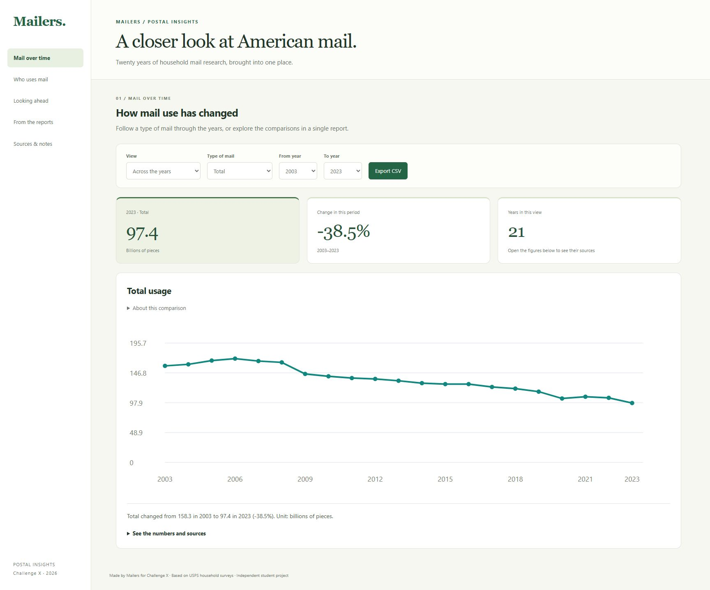

# Mailers · Postal Insights

A local dashboard for exploring how American households use the mail. Built by team **Mailers** for the USPS Office of Inspector General's Challenge X use case.



## Open the dashboard

Download the repository ZIP, extract it, and open **index.html** in your browser. Or double-click **Open Mailers.cmd** on Windows.

No account, API key, installation or internet connection is needed. Keep the folders together so the data and PDF links work.

For a local server instead, run:

```sh
python app.py
```

## What's inside

- **Mail over time** — annual mail-market comparisons, 2003–2023, with newer per-household results available by report edition.
- **Who uses mail** — 19 household groups across age, income, education, ownership and geography in the 2025 survey.
- **Looking ahead** — forecast scenarios, with separate validation, held-out results and a simple baseline.
- **From the reports** — relevant source passages selected by extractive NLP, each linked to its PDF page.
- **Sources & notes** — original reports, CSV exports and the assumptions behind the charts.

## Project layout

```text
index.html           Dashboard
assets/              Styles and browser code
data/                Structured data and extracted report text
reports/             Source PDFs
scripts/             Data preparation
tests/               Data checks
docs/                Methods, presentation script and submission notes
demo/                Backup screenshots
app.py               Optional local server
```

The PowerPoint is delivered separately from the application.

## Rebuild the data

PDF extraction uses pypdf; the other preparation scripts use Python's standard library.

```sh
python -m pip install -r requirements.txt
python scripts/ingest.py
python scripts/build_data.py
python scripts/finish_data.py
python -m unittest discover -s tests
```

The ingestion script looks in Downloads and Downloads/Python Bootcamp on the current machine. The checked-in data lets you use the dashboard without running extraction.

## A note on interpretation

The historical series preserves published revisions but does not resolve every classification change. The newer per-household results are kept separate from aggregate billions of pieces. Projections use a **2023 cutoff** and are exploratory; their error and baseline comparison are visible. Summaries select existing sentences rather than generate new explanations.

Read [the methods](docs/METHODS.md) for details, or [the presentation script](docs/PRESENTATION.md) for a guided demo. This is an independent student project, not an official USPS product. The challenge's 50% preparation-time reduction remains an evaluation target, not a measured result.
